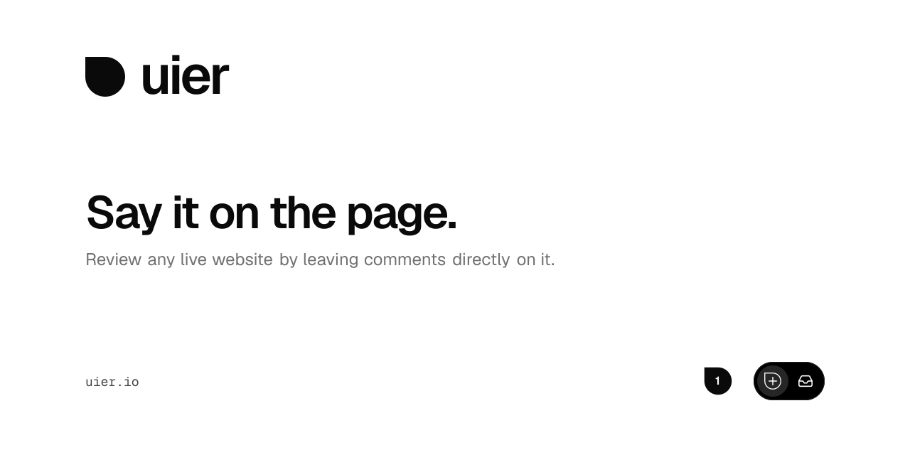

  <a href="https://www.signalco.io">
    <picture>
      <source media="(prefers-color-scheme: dark)" srcset="https://www.signalco.io/LogotypeDark.png">
      
    </picture>
  </a>

<h4 align="center">Automate your life.</h4>

Welcome to signalco's GitHub. Start with [signalco](https://github.com/signalco-io/signalco), or
explore the pinned repositories below.

## uier

Review any live website by leaving comments directly on it. Pin feedback to an element or selected
text, discuss it with your team, and mark it done. Each comment keeps the browser and viewport it
was left from, with a screenshot when capture succeeds.

[Try uier](https://uier.io) · [Open the app](https://uier.io/app) · [Source code](https://github.com/signalco-io/uier) · [Documentation](https://github.com/signalco-io/uier/blob/main/docs/README.md)

Every feature available today is free and will stay free forever. If we introduce pricing, it will
apply only to new features users want.

A signalco project. For product help, email [contact@signalco.io](mailto:contact@signalco.io).
For bugs and ideas, [open an issue](https://github.com/signalco-io/uier/issues/new/choose).
